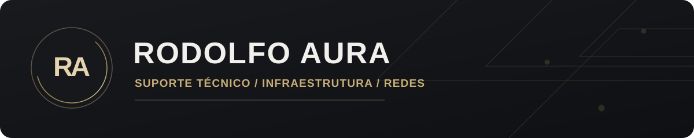

  

Profissional de **suporte técnico e infraestrutura**, com **4 anos de experiência** em ambientes corporativos e educacionais. Sou graduando em Ciência da Computação e tenho interesse especial em diagnóstico de problemas, redes, organização de ambientes de TI e melhoria de processos.

Meu foco profissional está na **operação e infraestrutura de TI**. Desenvolvimento web, automação e protótipos são atividades complementares que utilizo para transformar necessidades práticas em ferramentas.

**[Portfólio](https://rodolfoaura.github.io/)** · **[Repositórios públicos](https://github.com/RodolfoAura?tab=repositories)**

## Áreas de atuação

- **Suporte técnico:** atendimento a usuários, investigação de falhas, manutenção e configuração de estações Windows e equipamentos.
- **Infraestrutura e redes:** diagnóstico de conectividade, Wi-Fi, switches, VLANs, pfSense e UniFi.
- **Operação e processos:** controle de ativos, documentação, organização de rotinas e suporte a ambientes educacionais e corporativos.

## Projetos e experiências selecionados

| Projeto | Aplicação prática |
| --- | --- |
| **Gestão de ativos de TI** | Sistema para cadastro e acompanhamento de equipamentos, movimentações, empréstimos, transferências e relatórios operacionais. |
| **Portal de Eventos TI** | Organização de solicitações de apoio, disponibilidade de equipamentos, checklists de validação e controles de acesso. |
| **IA Suporte TI — TechDay** | Protótipo acadêmico para triagem conversacional, classificação de chamados e avaliação de prioridade com apoio de modelos de IA. |
| **[Portfólio pessoal](https://rodolfoaura.github.io/)** | Apresentação da minha atuação em suporte e infraestrutura, com [código público no GitHub](https://github.com/RodolfoAura/RodolfoAura.github.io). |

> Os projetos institucionais são apresentados apenas em nível funcional. Seus repositórios e dados internos não são públicos.

## Ferramentas e tecnologias

**Suporte e infraestrutura:** Windows, redes locais, Wi-Fi, VLANs, pfSense, UniFi e troubleshooting.

**Projetos complementares:** Git/GitHub, TypeScript, React, Python, Supabase e prototipação de jogos.

---

Aberto a oportunidades em suporte técnico, infraestrutura e operações de TI.
