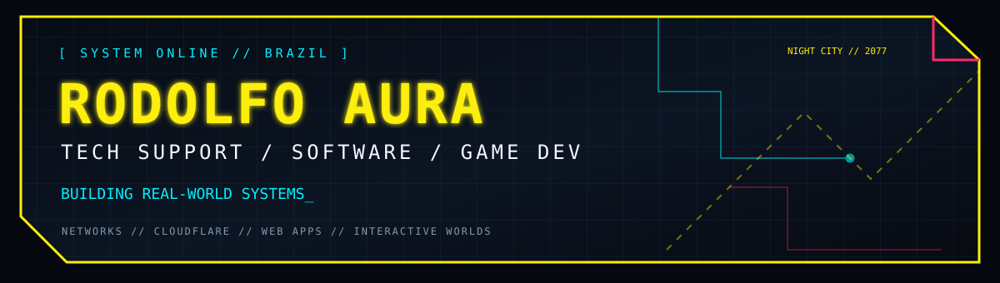
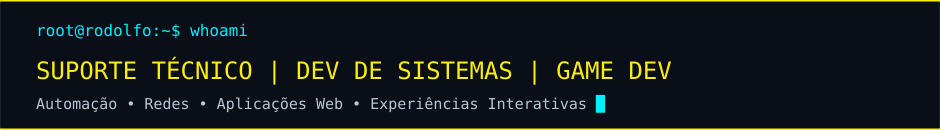
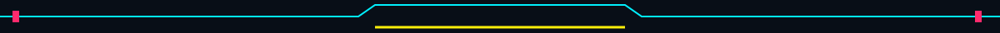

 

  

## `// 01 — IDENTIDADE`

> **Tecnologia com propósito.** Trabalho com suporte técnico e infraestrutura, e também desenvolvo aplicações e jogos, conectando solução de problemas, interfaces e engenharia de software.

- **Infraestrutura:** suporte a ambientes com laboratórios e estações de trabalho, redes, Wi-Fi, switches e troubleshooting.
- **Redes e segurança:** VLANs, UniFi, pfSense, regras de acesso e diagnóstico.
- **Desenvolvimento:** aplicações web, integração de serviços, interfaces e automações.
- **Game development:** sistemas de jogo, multiplayer, interfaces e prototipação.

## `// 02 — TECH STACK`

## `// 03 — PROJETOS EM FOCO`

<table>
<tr>
<td width="50%" valign="top">

### [MEU FINANCEIRO](https://github.com/RodolfoAura/meu-financeiro)

Aplicação pessoal de gestão financeira com contas, movimentações, cartões, recorrências e visualização de indicadores.

**Foco:** UX, organização financeira, importação de dados e experiência responsiva.

</td>
<td width="50%" valign="top">

### [POKÉARENA](https://github.com/RodolfoAura/PokeArena)

Jogo web experimental com jornada, batalhas e recursos multiplayer para uso privado entre amigos.

**Foco:** sincronização, experiência de jogo e interfaces.

</td>
</tr>
<tr>
<td valign="top">

### [ELDRAVALE / ELDRAVE](https://github.com/RodolfoAura/Eldrave)

Protótipos de RPG e exploração de sistemas de combate, personagens, animações e cenários.

**Foco:** game design e experimentação.

</td>
<td valign="top">

### [OUTROS REPOSITÓRIOS](https://github.com/RodolfoAura?tab=repositories)

Projetos acadêmicos, estudos, exercícios e experimentos em desenvolvimento e infraestrutura.

**Foco:** aprendizado contínuo.

</td>
</tr>
</table>

> Alguns repositórios em destaque são **privados**: os links só abrem para contas autorizadas. Esta seção apresenta os projetos sem expor código confidencial.

## `// 04 — TELEMETRIA DE DESENVOLVIMENTO`

## `// 05 — ACESSO AO SISTEMA`

**SYSTEM STATUS: ONLINE** · **LOCATION: BRASIL** · **MODE: BUILD / LEARN / IMPROVE**

Inspired by futuristic interfaces and the cyberpunk aesthetic. Original custom SVG artwork.

